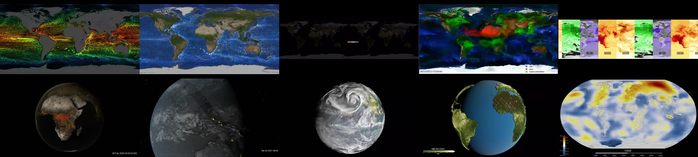

# 🌍🎵 Earth Jukebox

**Hear our planet change.** Earth Jukebox plays NASA Earth Information Center (EIC) visualizations as music,
generated in real time from the frames themselves — with a voice-guided mode so blind and low-vision
visitors can explore it without ever seeing the screen.

NASA Space Apps Challenge 2026 · challenge **[The Earth Information Jukebox](https://www.spaceappschallenge.org/2026/challenges/the-earth-information-jukebox/)** · team **Rock Cycle** (Kyiv)

**▶ Live demo:** https://hort1934.github.io/rock-cycle-earth-jukebox/



## Why

Earth science is mostly shown as pictures: colored maps, glowing globes, swirling flows on the EIC hyperwall.
That leaves out people who cannot see them, and it often leaves everyone else with a pretty image but no
feeling for what is changing. Earth Jukebox turns each visualization into a piece of music where
**every note is driven by the data on screen**, so you can *hear* smoke crossing the Atlantic,
lightning following the seasons, or 143 years of warming taking over the map.

## What it does

- **10 EIC visualizations on a record shelf** — ocean temperature and currents, aerosols, air quality,
  CO₂, lightning from the ISS, an atmospheric river, forest height, night lights and global temperature
  anomalies. Pick one and it starts to play.
- **Real-time sonification of the actual frames.** A playhead scans each video frame; pixels are split into
  layers using the visualization's own color bar (dust is red, sea salt is blue, warm anomaly is yellow → red…),
  and every layer plays its own instrument.
- **Voice-guided mode** (idea by Catalina): a black, high-contrast screen that *talks*. It asks questions —
  *"Is this your first time here?"*, *"Which part of Earth would you like to hear?"* — and you answer
  by voice (Web Speech API) or with number keys. It can describe the scene, explain the mapping, change the
  style and skip records, all hands-free.
- **Six musical styles** — Pure data, Ambient, Orchestral, Electronic, Jazz, Lo-fi. A style changes only the
  instruments and the room; **pitch, rhythm and loudness always come from the data**, so the science stays
  the same while the listener picks something they enjoy.
- **Accessible by design:** screen-reader descriptions for every record (*what you see* / *what you hear*),
  live narration of the current frame, full keyboard control, vibration on percussive events on phones,
  `prefers-reduced-motion` support.
- **Record & download** any session as an audio file — a ready-made "playlist" track for the gallery,
  a podcast or a classroom.
- **Bring your own visualization:** drop any EIC frame or video and hear it with a generic warm / cool / bright split.
- No backend, no build step: static HTML + ES modules + [Tone.js](https://tonejs.github.io/), deployable on GitHub Pages.

## How sight becomes sound

```
EIC video (NASA SVS) ──► frame, averaged down to a ~72-row grid (area filter keeps tiny flashes)
        │
        ▼
color rules from each visualization's color bar  ──►  layers (dust, smoke, warm anomaly, vapor, …)
        │                                                 per column: amount · height · value · sudden change
        ▼
playhead: 32 steps per sweep (2 bars), left → right = west → east on flat maps
        │
        ▼
Tone.js instruments (one family per layer role) ──► reverb / compressor / limiter ──► speakers + recorder
```

| What the data does | What you hear | Why |
| --- | --- | --- |
| Value on the color bar (temperature, concentration, forest height…) | **Pitch**, kept inside a musical mode | Higher value = higher note; the mode keeps it musical instead of noisy |
| Position north/south (for "height" layers such as city lights) | **Pitch** | The planet's shape becomes a melody line |
| How much of a layer is in the scanned column / on screen | **Loudness**, note density | More smoke = louder smoke |
| Position west → east | **Stereo pan** and **time** within the sweep | Americas on the left, Asia on the right |
| Layer suddenly appears (lightning, new plumes) | **Percussion** + phone vibration | Events become rhythm |
| Whole-scene brightness, motion and "tension" | Low **drone**: filter, tremolo, detune | A busy or warming planet literally trembles |

Every layer has one **role**: *melody* (a note per step), *pad* (a chord per bar), *bass*, *percussion*
(on sudden appearance) or *texture* (continuous noise). The table of layers for each record is shown live in
the mixer, with meters, and can be toggled with keys <kbd>1</kbd>–<kbd>4</kbd>.

### The ten records

| Record | NASA SVS | Layers → roles | Story you can hear |
| --- | --- | --- | --- |
| Global Sea Surface Currents and Temperature | [#3912](https://svs.gsfc.nasa.gov/3912/) | temperature → melody, warm water → chords, cold water → bass | Tropics sing high, polar seas hum low |
| Perpetual Ocean 2 (equirectangular) | [#5505](https://svs.gsfc.nasa.gov/5505/) | current trails → melody, open ocean → chords, busy flow → texture | Western boundary currents as bright runs of notes |
| Change in Night Lights 2012–2023 (EIC) | [#5313](https://svs.gsfc.nasa.gov/5313/) | city lights → melody, more light → chords, less light → bass | Loss of light (e.g. Ukraine after 2022) as a darker bass |
| GEOS Aerosols | [#4582](https://svs.gsfc.nasa.gov/4582/) | smoke & pollution → melody, dust → chords, sea salt → texture | Saharan dust crossing the Atlantic |
| Air Quality Model Runs (EIC hyperwall) | [#5533](https://svs.gsfc.nasa.gov/5533/) | CO & PM2.5 → melody, NOx → chords, ozone → bass, fire plumes → drums | Four pollutants as four verses |
| DYAMOND Global Carbon Dioxide | [#5196](https://svs.gsfc.nasa.gov/5196/) | CO₂ haze → melody, strong sources → chords, flares → drums | The daily "breathing" of the planet |
| Lightning from the ISS 2017–2023 | [#5011](https://svs.gsfc.nasa.gov/5011/) | new flashes → drums, storm belts → melody, clouds → texture | Lightning following the seasons |
| A 3D View of an Atmospheric River | [#4960](https://svs.gsfc.nasa.gov/4960/) | water vapor → melody, clouds → chords, new cloud bands → drops | The Pineapple Express building toward the coast |
| GEDI Forest Height | [#4950](https://svs.gsfc.nasa.gov/4950/) | canopy height → melody, tallest forest → chords, short vegetation → bass | Rainforests as the highest strings |
| Global Temperature Anomalies 1880–2023 | [#5207](https://svs.gsfc.nasa.gov/5207/) | warm → melody, cold → chords, extreme heat → drums; tension = warm − cold | Calm in 1880, tense and crowded by 2023 |

Long hyperwall pieces (lightning, atmospheric river) are played as 1-minute time-lapses; the description says so.

### Honest limits

- Values are read from **colors**, not from the original NetCDF data. Each layer uses the color bar of its
  visualization, so pitch follows the color scale, not an exact physical number.
- On globes the west → east reading is approximate (it follows the view, not longitude).
- The optional **style groove** (drums in Electronic / Jazz / Lo-fi) is the only sound that is *not* data;
  it is labeled "not data" in the UI and can be switched off.

## Accessibility

| Need | What Earth Jukebox does |
| --- | --- |
| Cannot see the screen | Voice-guided mode: spoken menus, voice or number-key answers, spoken descriptions and mapping explanations |
| Uses a screen reader | Real buttons and labels, live region with frame descriptions, every record has *what you see* / *what you hear* text |
| Keyboard only | <kbd>Space</kbd> play/pause · <kbd>←</kbd><kbd>→</kbd> records · <kbd>↑</kbd><kbd>↓</kbd> tempo · <kbd>D</kbd> describe · <kbd>G</kbd> style · <kbd>1</kbd>–<kbd>4</kbd> layers · <kbd>V</kbd> voice mode · <kbd>Esc</kbd> exit |
| Deaf or hard of hearing | Live text narration, per-layer meters, scan line with colored dots on the video |
| Phone users | Vibration on percussive events (lightning, plumes) |
| Motion sensitivity | Animations stop with `prefers-reduced-motion` |

Speech recognition works in Chrome, Edge and Safari; everywhere else the same menus are answered with keys.

## Run locally

```bash
python tools/serve.py        # http://localhost:8000 (no-cache dev server with video seeking support)
```

Rebuild the video clips from NASA SVS (downloads ~600 MB of originals into `.cache/`, outputs ~35 MB to `media/`):

```bash
pip install imageio-ffmpeg   # or have ffmpeg on PATH
python tools/build_media.py  # all records, or e.g. `python tools/build_media.py lightning`
```

Checks (the same as CI):

```bash
npm run lint    # syntax of every ES module
npm run check   # catalog ↔ media ↔ page consistency, descriptions, media budget
```

## Project structure

```
index.html              page, player, shelf, voice-mode dialog
css/style.css           dark "record shelf" design, high-contrast voice screen
js/
  catalog.js            the 10 EIC records: layers, color rules, roles, key & mode, descriptions, credits
  analysis.js           frame analyzer: area-averaged downsampling, HSV, per-layer column features
  audio.js              sonification engine and the six styles (Tone.js)
  describe.js           text descriptions of the current frame and of the mapping
  voice.js              voice-guided mode (speech synthesis + recognition + key fallback)
  main.js               wiring: shelf, player, mixer, overlay, recording, keyboard
media/                  web-sized clips + posters made by tools/build_media.py, manifest.json
tools/                  build_media.py · serve.py · check.mjs
vendor/Tone.js          Tone.js 14.8.49 (MIT), vendored so the demo works without a CDN
.github/workflows/      ci.yml (checks on every PR) · pages.yml (deploy to GitHub Pages on main)
```

## CI / CD

- **CI** (`.github/workflows/ci.yml`) runs on every pull request and push to `main`: ES-module syntax check,
  catalog/media/page consistency (`tools/check.mjs`), HTML validation (`html-validate`) and a Python compile check.
- **Deploy** (`.github/workflows/pages.yml`) re-runs the checks and publishes the static site to GitHub Pages
  on every push to `main`. Enable it once in *Settings → Pages → Source: GitHub Actions*.
- Dependabot keeps the GitHub Actions versions up to date.

## NASA data & credits

All visualizations come from NASA's [Scientific Visualization Studio](https://svs.gsfc.nasa.gov/) and the
[Earth Information Center gallery](https://svs.gsfc.nasa.gov/gallery/earth-information-center/):

- Global Sea Surface Currents and Temperature — NASA/GSFC SVS; ECCO2 (MIT/JPL). [svs.gsfc.nasa.gov/3912](https://svs.gsfc.nasa.gov/3912/)
- Perpetual Ocean 2: Equirectangular — NASA SVS; ECCO-2 (NASA/JPL, MIT, UT Austin). [svs.gsfc.nasa.gov/5505](https://svs.gsfc.nasa.gov/5505/) (see also [#5425](https://svs.gsfc.nasa.gov/5425/))
- Change in Night Lights 2012–2023, EIC version — NASA SVS; Black Marble, Suomi NPP VIIRS. [svs.gsfc.nasa.gov/5313](https://svs.gsfc.nasa.gov/5313/)
- Aerosol Optical Thickness (GEOS aerosols) — NASA SVS; NASA GMAO GEOS. [svs.gsfc.nasa.gov/4582](https://svs.gsfc.nasa.gov/4582/) (see also [#5669](https://svs.gsfc.nasa.gov/5669/))
- Air Quality Model Runs — NASA SVS & NASA GMAO GEOS-CF. [svs.gsfc.nasa.gov/5533](https://svs.gsfc.nasa.gov/5533/)
- DYAMOND Global Carbon Dioxide — NASA SVS; GEOS / DYAMOND. [svs.gsfc.nasa.gov/5196](https://svs.gsfc.nasa.gov/5196/)
- Lightning Events Detected from the ISS 2017–2023 — NASA SVS; ISS LIS (NASA GHRC DAAC). [svs.gsfc.nasa.gov/5011](https://svs.gsfc.nasa.gov/5011/)
- A 3D View of an Atmospheric River — NASA SVS; MERRA-2 (NASA GMAO). [svs.gsfc.nasa.gov/4960](https://svs.gsfc.nasa.gov/4960/)
- GEDI Forest Height — NASA SVS; GEDI (University of Maryland / NASA). [svs.gsfc.nasa.gov/4950](https://svs.gsfc.nasa.gov/4950/)
- Global Temperature Anomalies 1880–2023 — NASA SVS; NASA GISS GISTEMP v4. [svs.gsfc.nasa.gov/5207](https://svs.gsfc.nasa.gov/5207/)
- Inspiration for the scanning approach: [Data Sonification: Caldwell 73](https://svs.gsfc.nasa.gov/13786/) (SYSTEM Sounds for NASA).

Clips in `media/` are re-encoded, shortened or time-lapsed copies made by `tools/build_media.py`; the originals
are linked above. NASA material is used under the [NASA media guidelines](https://www.nasa.gov/nasa-brand-center/images-and-media/);
NASA does not endorse this project.

Software: [Tone.js](https://github.com/Tonejs/Tone.js) (MIT), [imageio-ffmpeg](https://github.com/imageio/imageio-ffmpeg) / FFmpeg for the media build only.

## Team Rock Cycle

- **Ihor Marchenko** — sonification engine, frame analysis, web app, CI/CD
- **Catalina Bratu** — voice-guided mode concept, musical styles concept, storytelling, accessibility, presentation

## License

[MIT](LICENSE) for the code. NASA visualizations keep their original credits (see above).
